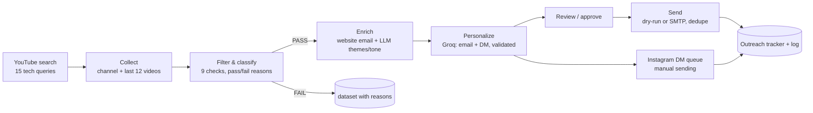

# Micro-Influencer Outreach Pipeline

EDXSO AI Engineer Intern, Assignment 1.

A Python pipeline that finds Technology micro-influencers on YouTube, filters them with explainable rules, enriches the shortlist with real contact and content data, writes a personalized email pitch and Instagram DM for each one with an LLM, and sends (or simulates sending) the emails with duplicate protection and a full outreach log.

Every number in the output comes from the YouTube Data API. Emails are only ever extracted from text the creator published themselves. Anything that isn't publicly available is written as `Not Found` / `Not Available`, never estimated.

## Submission contents

| Requirement | Where to find it |
|---|---|
| GitHub repository / project files | This repo: source in [`src/`](src/), CLI in [`run_pipeline.py`](run_pipeline.py), config in [`config.yaml`](config.yaml) |
| README / documentation | This file |
| Working demo / screenshots | [`docs/DEMO.md`](docs/DEMO.md): screenshots, real run log, re-run proof. Live report: [`outputs/report.html`](outputs/report.html) |
| Influencer dataset (50+) | [`outputs/influencers_dataset.csv`](outputs/influencers_dataset.csv): 155 channels with PASS/FAIL reasons. [`outputs/shortlist.csv`](outputs/shortlist.csv): the 25 that passed |
| Sample personalized messages | [`docs/SAMPLE_MESSAGES.md`](docs/SAMPLE_MESSAGES.md) (all 25) and [`outputs/personalized_messages.csv`](outputs/personalized_messages.csv) |
| Outreach tracker | [`outputs/outreach_tracker.csv`](outputs/outreach_tracker.csv), log in [`outputs/outreach_log.csv`](outputs/outreach_log.csv), sample email in [`docs/sample_sent_email.eml`](docs/sample_sent_email.eml) |
| Automation workflow | [`docs/WORKFLOW.md`](docs/WORKFLOW.md) |
| Setup instructions | [Quick start](#quick-start) below |
| List of APIs / tools used | [APIs and tools used](#apis-and-tools-used) below |
| Everything in one file | [`outputs/outreach_report.xlsx`](outputs/outreach_report.xlsx): Dataset, Shortlist, Messages, Tracker, DM Queue and Log sheets |

**Results of the test run:** 155 channels discovered → 25 passed filtering → 12 with a public contact email → 25 email pitches + 25 Instagram DMs generated and validated → 12 emails sent (dry-run) → 25 DMs queued for manual sending.



## Quick start

```bash
git clone <this repo> && cd influencer-outreach
python -m venv .venv && source .venv/bin/activate      # Windows: .venv\Scripts\activate
pip install -r requirements.txt
cp .env.example .env                                     # then add your keys
python -m pytest -q                                      # 34 offline tests, no keys needed

python run_pipeline.py run --auto-approve                # full run, emails simulated
```

You need two free keys in `.env`:

| Key | Where to get it |
|---|---|
| `YOUTUBE_API_KEY` | Google Cloud console → enable **YouTube Data API v3** → Credentials → API key |
| `GROQ_API_KEY` | console.groq.com/keys |

SMTP settings are only needed for real sending (see [Sending](#sending-layer)).

A full run takes a few minutes (most of it is polite rate-limiting on the LLM). Results land in `outputs/`:

| File | What's in it |
|---|---|
| `influencers_dataset.csv` | Every discovered channel (target 150) with metrics, email, themes, PASS/FAIL and the exact fail reasons |
| `shortlist.csv` | Only the channels that passed |
| `personalized_messages.csv` | Email subject + pitch, Instagram DM, word counts, collaboration angle, validation result |
| `outreach_tracker.csv` | Influencer, email, message generated, sent, date, status |
| `instagram_dm_queue.csv` | Profile link + ready-to-paste DM for manual sending |
| `outreach_log.csv` | Append-only log of every send, skip and failure |
| `outreach_report.xlsx` | All of the above as sheets |
| `report.html` | One-page visual report (good for screenshots/demo) |
| `outbox/*.eml` | The exact emails that would be sent in dry-run mode |

## Running stage by stage

Every stage reads and writes the same SQLite database (`outputs/pipeline.db`), so you can stop and resume anywhere.

```bash
python run_pipeline.py discover          # search YouTube, store unique channel IDs
python run_pipeline.py collect           # channel stats + recent videos + public contacts
python run_pipeline.py filter            # apply rules (use --refilter after editing config.yaml)
python run_pipeline.py enrich            # website email lookup + LLM content analysis
python run_pipeline.py personalize       # generate email + DM (--regenerate to redo)
python run_pipeline.py review            # read the drafts in the terminal
python run_pipeline.py approve --all     # or: approve --ids UCxxxx UCyyyy
python run_pipeline.py send              # dry-run by default; --mode smtp for real
python run_pipeline.py dm-queue          # build the manual Instagram DM queue
python run_pipeline.py dm-mark --id UCxxxx   # after sending a DM by hand
python run_pipeline.py export            # write CSV / XLSX / HTML
python run_pipeline.py status
```

## APIs and tools used

- **Python 3.10+**: `requests`, `PyYAML`, `python-dotenv`, `openpyxl`, `pytest`
- **SQLite** for state, API response cache and the outreach log
- **YouTube Data API v3** for discovery and metrics
- **Groq** (`qwen/qwen3.8-27b`, OpenAI-compatible endpoint, JSON mode) for content analysis and message writing. `llm.provider` can also be `openai` or `xai` (set `OPENAI_API_KEY` / `XAI_API_KEY`)
- **SMTP** (Gmail App Password works) for sending, plus a dry-run mode that writes `.eml` files
- **GitHub Actions** runs the test suite on every push

| API / tool | Used for |
|---|---|
| YouTube Data API v3 (`search.list`, `channels.list`, `playlistItems.list`, `videos.list`) | Discovery, follower counts, per-video views/likes/comments, descriptions |
| Groq API (OpenAI-compatible chat completions, JSON mode) | Content analysis (themes, tone, sub-niche) and message writing |
| SMTP (`smtplib`, Gmail App Password) | Real email sending. Dry-run mode writes `.eml` files instead |
| Creator websites (HTTP + `robots.txt`) | Finding a published contact email when YouTube has none |
| SQLite | Workflow state, API cache, outreach log |
| openpyxl | Excel report |
| pytest + GitHub Actions | Offline test suite with fake API/LLM clients |

## Data sources

| Data | Source |
|---|---|
| Channel list | `search.list` (type=video, last 90 days, region bias IN) |
| Subscribers, total views, country, description, topic categories, made-for-kids flag | `channels.list` |
| Last 12 uploads with views, likes, comments, duration, tags, description | `playlistItems.list` + `videos.list` |
| Contact email | Channel description → recent video descriptions → the creator's own linked website |
| Instagram / TikTok / X / LinkedIn / website | Links in the channel and video descriptions |

## Discovery methodology

The niche is **Technology**, chosen because it fits an EdTech brand: coding tutorials, AI tools, gadgets, PC builds, cybersecurity and edtech-for-teachers creators.

15 search queries are listed in `config.yaml`. I search **videos posted in the last 90 days** rather than channels, because channel search mostly returns huge, well-known channels, while video search surfaces people who are actively posting right now, which is where micro-creators show up. Channel IDs are de-duplicated across queries and each record remembers which queries found it. Discovery stops at `target_candidates` (150 by default, well above the 50 required).

## Filtering logic

Filtering happens after stats are collected, because engagement and activity need real video data. Each channel gets a checklist; any failed check fails the channel, and the reason is written into the dataset (for example `Subscriber count: 245000 (needs 5,000-100,000) - above micro range`).

| Check | Rule (editable in `config.yaml`) |
|---|---|
| Platform | YouTube |
| Subscribers | 5,000 to 100,000. Hidden counts fail |
| Engagement rate | ≥ 1% and computed from at least 3 recent videos |
| Recent activity | Uploaded within the last 60 days |
| Niche relevance | Score ≥ 0.35 (below) |
| Geography | Channel country, optional allow-list (off by default) |
| Audience demographics | Recorded as *Not Available*, never failed or guessed (see Limitations) |
| Brand safety | No blocklisted terms (betting, casino, mod apk, ...) in titles/description |
| Not made for kids | Made-for-kids channels have comments off and strict ad rules |

**Engagement rate** = sum of (likes + comments) / sum of views over the last 10 uploads that are at least 3 days old. Videos with hidden likes are left out of the calculation instead of being filled in. If no video has usable numbers, ER is `Not Available` and the channel fails that check.

**Niche relevance score (0 to 1)**:
`0.55 × share of recent titles with tech keywords + 0.25 × keyword hits in description/channel keywords (capped) + 0.20 if YouTube tags the channel as Technology`.

The same keyword groups classify each channel into a **sub-niche**: Gadgets & Reviews, Programming & Web Dev, AI & Productivity Tools, Data Science & ML, PC & Hardware, Cybersecurity, EdTech & Learning Tech. Channels also get a **tier** (emerging / mid / upper micro) and an **educational ratio** (share of titles that are tutorials, explainers, "how to", etc.), which feeds the collaboration angle.

## Enrichment process

For every shortlisted channel:

1. **Email**. If no email was found in YouTube descriptions, the pipeline visits the website the creator linked in their channel description (home, `/contact`, `/about`, up to 3 pages), checks `robots.txt` first, and only reads addresses printed on the page or in `mailto:` links. Obfuscated forms like `name [at] gmail [dot] com` are decoded. Image filenames, `noreply@`, `example.com` and similar junk are rejected. Business-sounding addresses (`collab@`, "for business enquiries") are preferred. If nothing turns up, the email is `Not Found`. The source of each email is stored next to it.
2. **Content context**. The LLM reads the channel description, keywords, top tags and the last 10 titles (with age and views) and returns content themes, tone, sub-niche, who the content seems made for, and a standout recent video. The output is checked: the standout video must exactly match a real title, field lengths are enforced, and the sub-niche must come from the allowed list. If the LLM call fails, keyword-based themes are used and labelled `keyword-fallback`.

### Mandatory fields coverage

| Field | Status |
|---|---|
| Name, platform, profile URL | Always present |
| Follower count | From API; "Hidden by creator" when hidden |
| Engagement rate | Computed; "Not Available" if likes are hidden on all recent videos |
| Category / niche, content themes | Always present (LLM or keyword-based) |
| Contact email | Extracted or "Not Found" |
| Instagram / TikTok / website | Extracted or "Not Found" |
| Audience age / gender / geography | "Not Available" (only the channel owner can see these) |

## AI model and prompts

Model: `qwen/qwen3.8-27b` on Groq (set in `config.yaml → llm.model`), JSON response mode. Two prompts, both in the source:

- `src/enrichment.py → ANALYSIS_SYSTEM` (temperature 0.2): describe the channel using only the given metadata, return themes / tone / sub-niche / audience / standout video.
- `src/personalization.py → MESSAGE_SYSTEM` (temperature 0.7): write as a real person on a partnerships team; address the channel by its exact name, never invent a personal name; mention at least one real video or theme; use only facts from the data; email 60-90 words, DM 15-30 words; avoid a list of cliché phrases; return `{email_subject, email_body, dm}`.

The user message is a JSON block of the creator's signals: channel name, sub-niche, themes, tone, 3 most recent titles with how long ago they were posted, standout video, inferred audience, country, the chosen collaboration angle and the brand info.

## Personalization logic

Messages are personalized at two levels so they never collapse into one template.

**1. The collaboration angle is picked per creator by rules** (`choose_angle`):

| Situation | Angle |
|---|---|
| 60%+ of recent uploads are Shorts | UGC content creation |
| Review-style gadget channel, few tutorials | Paid product placement |
| ER ≥ 4% and under 30K subs | Brand ambassador program |
| Under 15K subs | Affiliate campaign (+ free premium access) |
| Educational / coding / AI / edtech content | Sponsorship (integration in a tutorial) |
| Otherwise | Sponsorship |

**2. The LLM writes from that creator's real signals**, and every draft is validated before it's accepted:

- email 60-90 words, DM 15-30 words
- mentions the channel name
- references a real recent title or theme (word overlap check)
- no placeholders like `[Name]`
- no numbers that aren't in the input data (catches invented stats)
- no banned clichés, no hashtags or links in the DM

If a draft fails, it's regenerated with the list of problems fed back (up to 3 attempts). A draft that still fails is saved as `needs_review` and is never auto-approved.

## Sending layer

`src/sending.py`

1. Picks shortlisted influencers that have a generated message **and a valid email**. The rest are logged once as `SKIPPED_NO_EMAIL`.
2. Requires the message to be **approved** (`approve` command, or `run --auto-approve`, which only approves drafts that passed validation).
3. **Duplicate prevention**: checks the log for the same channel *or the same email address* (two channels managed by one agency often share an inbox). A real `SENT` blocks every future send. A dry run (`SIMULATED`) or test send (`SENT_TEST`) only blocks repeats in the same mode, so testing never stops the real send later.
4. Builds a proper email: subject, AI-written body, signature, an opt-out line and a `List-Unsubscribe` header.
5. Sends it:
   - `dry-run` (default) writes the email to `outputs/outbox/<channel_id>.eml` and logs `SIMULATED`
   - `smtp` sends through your SMTP server and logs `SENT` or `FAILED` with the error. Failed sends can simply be retried.
   - With `sending.test_recipient_override` set, SMTP mail goes to your own inbox instead, logged `SENT_TEST` with the intended recipient recorded. This is the safe way to demo real sending.
6. Respects a daily cap and a delay between sends.

To send for real with Gmail: turn on 2-Step Verification, create an App Password, put it in `.env` as `SMTP_PASSWORD` with `SMTP_USER`, then `python run_pipeline.py send --mode smtp`.

### Instagram DMs

Meta's Instagram Messaging API lets a business account reply to people who messaged it first; it doesn't allow cold outreach DMs, and automating the Instagram app would break its terms. So DMs are **not** sent automatically. `dm-queue` produces a list of Instagram profile links (when the creator linked one) with the ready-to-paste DM. After sending one by hand, `dm-mark --id <channel_id>` logs it, and marking the same creator twice is refused.

## Error handling

- YouTube: retries with backoff on 429/5xx and rate limits, stops cleanly on quota exhaustion, keeps its own quota budget (8,000 of the 10,000 daily units), and caches responses for 24 hours so re-runs cost nothing.
- Deleted/private channels, hidden subscriber counts, hidden likes, disabled comments, live streams and channels with no uploads are all handled and show up as explicit reasons in the dataset.
- LLM: throttled between calls, honours `retry-after` on 429, retries 5xx, and tolerates `<think>` blocks / code fences around the JSON. A bad key or unknown model (401/403/404) stops the stage after one call with a clear error instead of failing every creator. If analysis fails, keyword themes are used and labelled `keyword-fallback`; the next `enrich` run retries those with the LLM automatically. A failed message generation is recorded as `failed` and is retried automatically on the next `personalize` run.
- After enrichment has been redone, run `personalize --regenerate` so messages use the new themes (messages that were really `SENT` are never rewritten).
- Website lookups are wrapped so one bad site can't break the run.
- SMTP: reconnects once on disconnect; every failure is logged with the error.

## Scalability (50 → 500+)

- Quota for the default run: 15 searches × 100 + ~2 units per channel ≈ **1,800 units** for 150 channels. 500 channels needs roughly 15-20 more search pages, still under the free 10,000/day. Beyond that, raise `pages_per_query`, add queries, and let the budget spread the work over several days; the cache and stage tracking make that resumable.
- `channels.list` and `videos.list` are batched 50 IDs per call.
- Stages only process records that need them, so adding queries later only touches new channels.
- LLM cost is 2 calls per *shortlisted* creator, not per discovered one. Groq's free tier has per-minute and per-day limits (see console.groq.com/settings/limits). For big batches, switch `llm.model` to a smaller model with higher limits or just re-run the next day; nothing gets reprocessed.
- To add a niche, add a keyword group in `src/filtering.py` and new queries in `config.yaml`. To add a platform, write a client with the same four methods as `YouTubeClient`.

## Limitations

- **Audience demographics** (age, gender, audience geography) are only visible to the channel owner in YouTube Analytics. They're marked `Not Available` everywhere. The only geo signal is the creator's own channel country, which many creators don't set. The "seems made for" field is clearly labelled as an inference from content, not analytics.
- **Emails**: YouTube's "View email address" button is behind a CAPTCHA and is deliberately not touched. Creators who only list their email there will show `Not Found`. Emails are checked for syntax and junk, but not verified with an SMTP probe.
- **Subscriber counts** from the API are rounded to 3 significant figures (e.g. 24,700).
- **Engagement rate** only covers likes and comments; shares and watch time aren't public.
- Search results depend on YouTube's ranking and the region bias, so different runs and days return different channels.
- Relevance scoring is keyword-based and English-leaning; Hindi-script titles count less than they should.
- Instagram follower counts and IG engagement are not collected (that would need the Instagram Graph API's business discovery with a connected business account, or a paid scraper).

## Project structure

```
run_pipeline.py          CLI for all stages
config.yaml              queries, thresholds, brand, sending settings
src/
  youtube_client.py      API client: quota, cache, retries
  discovery.py           discover + collect stages
  metrics.py             engagement / activity metrics
  extractors.py          email, social link and website extraction
  filtering.py           rules, relevance score, sub-niche classification
  website_scraper.py     robots-aware contact page lookup
  enrichment.py          email lookup + LLM content analysis
  llm.py                 LLM client (Groq / OpenAI / xAI), JSON parsing, retries
  personalization.py     angle rules, prompts, validation, retries
  sending.py             dry-run / SMTP senders, dedupe, log
  dm_workflow.py         manual Instagram DM queue
  export.py              CSV, XLSX, HTML report
  storage.py             SQLite schema and queries
tests/                   offline tests with fake API + fake LLM
docs/                    demo + screenshots, sample messages, workflow
outputs/                 dataset, shortlist, messages, tracker, log, XLSX, HTML report
```

The tests use clearly synthetic channels (`Test Tech Ankit`, `*.example.test` emails) to check every stage end to end without network access. None of that fixture data is ever written to the real outputs.
