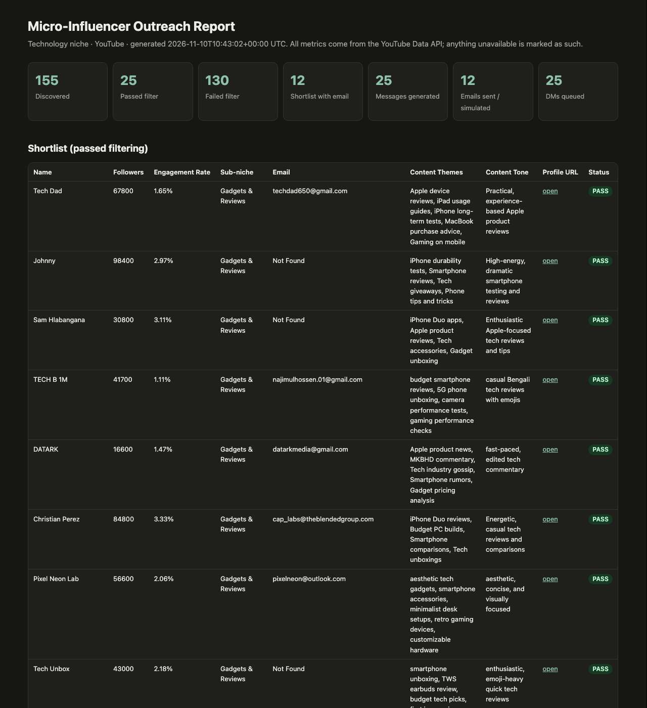
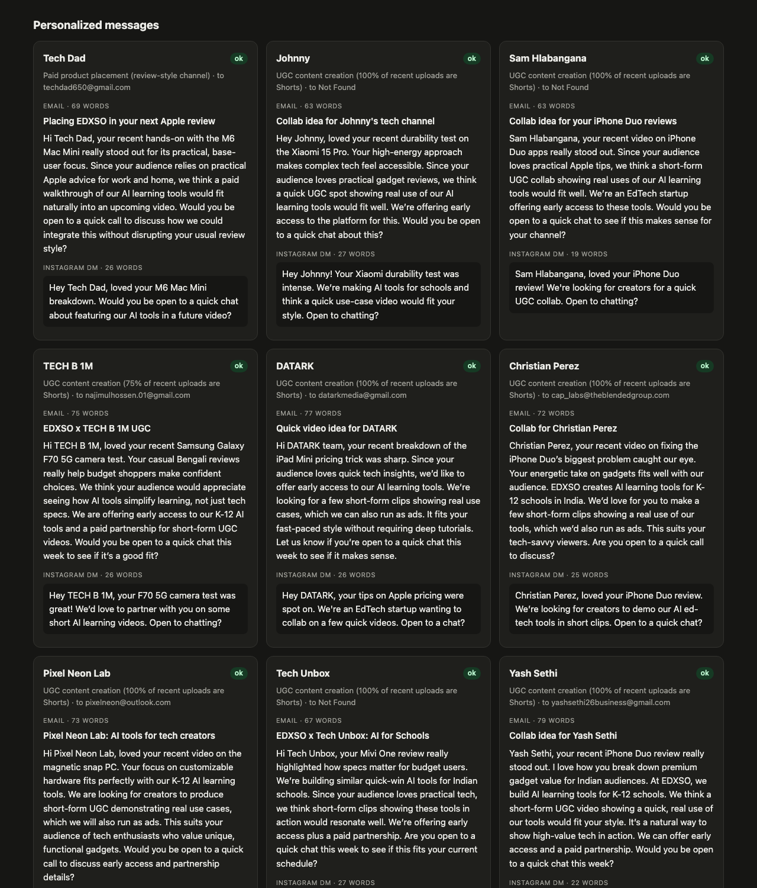
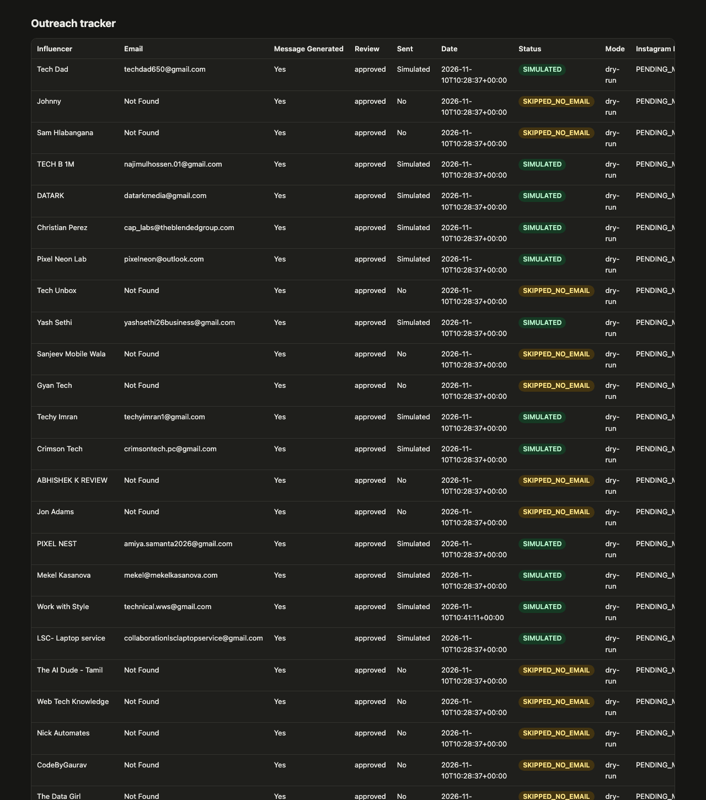
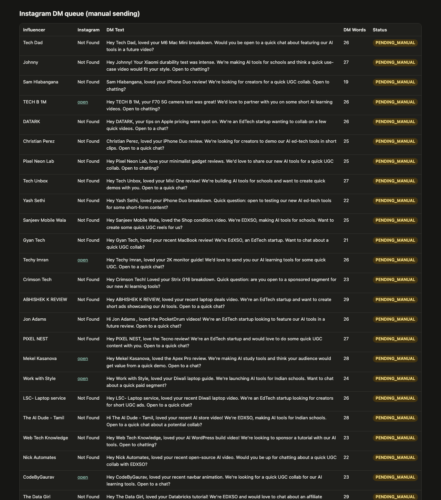
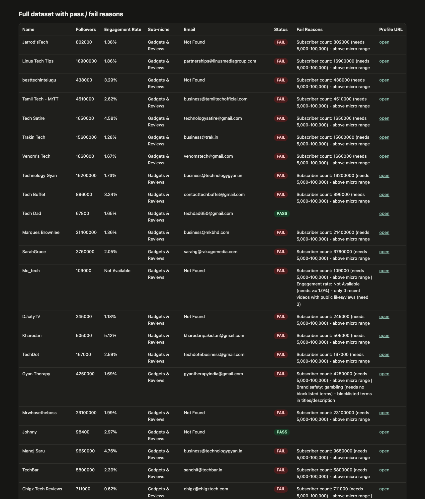

# Working Demo

Evidence that the full pipeline runs end to end on real data. Screenshots are of `outputs/report.html`, which the pipeline generates (open it in a browser for the live version).

## Screenshots

| | |
|---|---|
| **1. Overview + shortlist**: headline numbers, then the creators that passed filtering with their metrics, email, LLM-written themes and tone |  |
| **2. Personalized messages**: email pitch + Instagram DM per creator, word counts, collaboration angle and validation status |  |
| **3. Outreach tracker**: influencer, email, message generated, review, sent, date, status, mode |  |
| **4. Instagram DM queue**: ready-to-paste DMs for manual sending (Meta doesn't allow cold DMs via API) |  |
| **5. Full dataset**: all 155 discovered channels with PASS / FAIL and the exact reason |  |

A real email produced by the sending layer (dry-run mode writes the exact RFC-5322 message it would send): [`sample_sent_email.eml`](sample_sent_email.eml).

## Pipeline run log (real run, excerpt from `outputs/pipeline.log`)

Discovery → collection → filtering → enrichment → personalization → approval → sending → DM queue:

```text
15:17:09 INFO      search 'tech review' -> 50 results, 39 new channels so far
15:17:09 INFO      search 'gadget review india' -> 50 results, 61 new channels so far
15:17:10 INFO      search 'smartphone review hindi' -> 50 results, 83 new channels so far
15:17:10 INFO      search 'laptop review' -> 50 results, 112 new channels so far
15:17:11 INFO      search 'coding tutorial for beginners' -> 50 results, 155 new channels so far
15:17:11 INFO    Discovery: {'new_channels': 155, 'total_channels': 155, 'searches_run': 5, 'quota_units_used': 500, 'stopped_reason': None}
15:20:44 INFO      collected 50/155 channels (quota used 104)
15:21:20 INFO      collected 100/155 channels (quota used 204)
15:21:51 INFO      collected 150/155 channels (quota used 304)
15:21:54 INFO    Collection: {'collected': 155, 'errors': 0, 'quota_units_used': 314}
15:21:54 INFO    Filtering: 25 passed, 130 failed
15:47:30 INFO      enriched 1/25: Tech Dad (email: found, themes: llm)
15:47:32 INFO      enriched 2/25: Johnny (email: Not Found, themes: llm)
15:47:35 INFO      enriched 3/25: Sam Hlabangana (email: Not Found, themes: llm)
15:50:09 INFO    Enrichment: {'enriched': 25, 'with_email': 12}
15:50:27 INFO      messages for Tech Dad: ok (2 attempts)
15:50:28 INFO      messages for Johnny: ok (1 attempt)
15:50:43 INFO      messages for Sam Hlabangana: ok (2 attempts)
15:58:36 INFO    Personalization: {'generated': 25, 'needs_review': 3, 'failed': 0, 'skipped': 0}
Approved 22 message(s)
15:58:37 INFO      SIMULATED -> Tech Dad (techdad650@gmail.com)
15:58:37 INFO      SIMULATED -> TECH B 1M (najimulhossen.01@gmail.com)
15:58:37 INFO      SIMULATED -> DATARK (datarkmedia@gmail.com)
15:58:37 INFO      SIMULATED -> Christian Perez (cap_labs@theblendedgroup.com)
15:58:37 INFO      SIMULATED -> Pixel Neon Lab (pixelneon@outlook.com)
15:58:37 INFO      SIMULATED -> Yash Sethi (yashsethi26business@gmail.com)
15:58:37 INFO      SIMULATED -> Techy Imran (techyimran1@gmail.com)
15:58:37 INFO      SIMULATED -> Crimson Tech (crimsontech.pc@gmail.com)
15:58:37 INFO      SIMULATED -> PIXEL NEST (amiya.samanta2026@gmail.com)
15:58:37 INFO      SIMULATED -> Mekel Kasanova (mekel@mekelkasanova.com)
15:58:37 INFO      SIMULATED -> LSC- Laptop service  (collaborationlsclaptopservice@gmail.com)
15:58:37 INFO    Sending: {'sent': 0, 'simulated': 11, 'skipped_duplicate': 0, 'skipped_no_email': 13, 'skipped_not_approved': 1, 'failed': 0}
15:58:37 INFO    DM queue: {'queued': 24, 'already_queued_or_done': 1, 'without_instagram_link': 19}
```

Discovery used 5 YouTube searches (500 quota units) to reach the 150-channel target; collection used 314 more units for 155 channels.

## Re-running is safe (resumable + duplicate protection)

Running the whole pipeline again does no repeated work and sends nothing twice: every stage skips records it has already processed, and the sending layer refuses to email anyone it already contacted.

```text
$ python -m pytest -q
..................................                                       [100%]
35 passed in 0.41s

$ python run_pipeline.py run --auto-approve
16:13:01 INFO    Discovery: {'new_channels': 0, 'total_channels': 155, 'searches_run': 0, 'quota_units_used': 0, 'stopped_reason': None}
16:13:01 INFO    Collection: {'collected': 0, 'errors': 0, 'quota_units_used': 0}
16:13:01 INFO    Filtering: 0 passed, 0 failed
16:13:01 INFO    Enrichment: {'enriched': 0, 'with_email': 0}
16:13:01 INFO    Personalization: {'generated': 0, 'needs_review': 0, 'failed': 0, 'skipped': 25}
16:13:01 INFO    Auto-approved 0 validated messages (needs_review ones are left for a human)
16:13:01 INFO      skip duplicate: Tech Dad (already SIMULATED on 2026-11-10)
16:13:01 INFO      skip duplicate: TECH B 1M (already SIMULATED on 2026-11-10)
16:13:01 INFO      skip duplicate: DATARK (already SIMULATED on 2026-11-10)
16:13:01 INFO      skip duplicate: Christian Perez (already SIMULATED on 2026-11-10)
16:13:01 INFO      skip duplicate: Pixel Neon Lab (already SIMULATED on 2026-11-10)
16:13:01 INFO      skip duplicate: Yash Sethi (already SIMULATED on 2026-11-10)
16:13:01 INFO      skip duplicate: Techy Imran (already SIMULATED on 2026-11-10)
16:13:01 INFO      skip duplicate: Crimson Tech (already SIMULATED on 2026-11-10)
16:13:01 INFO      skip duplicate: PIXEL NEST (already SIMULATED on 2026-11-10)
16:13:01 INFO      skip duplicate: Mekel Kasanova (already SIMULATED on 2026-11-10)
16:13:01 INFO      skip duplicate: Work with Style (already SIMULATED on 2026-11-10)
16:13:01 INFO      skip duplicate: LSC- Laptop service  (already SIMULATED on 2026-11-10)
16:13:01 INFO    Sending: {'sent': 0, 'simulated': 0, 'skipped_duplicate': 12, 'skipped_no_email': 13, 'skipped_not_approved': 0, 'failed': 0}
16:13:01 INFO    DM queue: {'queued': 0, 'already_queued_or_done': 25, 'without_instagram_link': 0}
16:13:02 INFO    Exported:
  /Users/aman/Downloads/influencer-outreach/outputs/influencers_dataset.csv
  /Users/aman/Downloads/influencer-outreach/outputs/shortlist.csv
  /Users/aman/Downloads/influencer-outreach/outputs/personalized_messages.csv
  /Users/aman/Downloads/influencer-outreach/outputs/outreach_tracker.csv
  /Users/aman/Downloads/influencer-outreach/outputs/instagram_dm_queue.csv
  /Users/aman/Downloads/influencer-outreach/outputs/outreach_log.csv
  /Users/aman/Downloads/influencer-outreach/outputs/outreach_report.xlsx
  /Users/aman/Downloads/influencer-outreach/outputs/report.html

Pipeline status
  influencers discovered : 155  {'filtered': 130, 'enriched': 25}
  passed / failed filter : 25 / 130
  shortlist with email   : 12
  messages               : 25 (ok 25, needs review 0, approved 25)
  outreach log entries   : {'email:SKIPPED_NO_EMAIL': 13, 'instagram_dm:PENDING_MANUAL': 25, 'email:SIMULATED': 12}

```

## Run it yourself

```bash
pip install -r requirements.txt
python -m pytest -q                       # offline tests, no API keys needed
cp .env.example .env                      # add YOUTUBE_API_KEY and GROQ_API_KEY
python run_pipeline.py run --auto-approve # full run, emails simulated (dry-run)
open outputs/report.html
```
