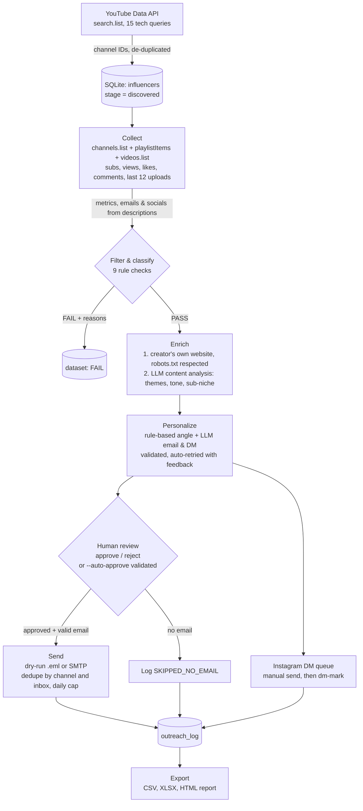

# Automation Workflow

The whole workflow is automated in Python and driven by one CLI (`run_pipeline.py`). Every stage reads and writes the same SQLite database (`outputs/pipeline.db`), which acts as the workflow's state store. That makes each stage resumable, safe to re-run and schedulable on its own.



## Stages and commands

| # | Stage | Command | Input → output | Automated? |
|---|---|---|---|---|
| 1 | Discovery | `discover` | search queries → unique channel IDs | Yes |
| 2 | Data collection | `collect` | channel IDs → stats, recent videos, ER, public contacts | Yes |
| 3 | Filtering & classification | `filter` | metrics → PASS/FAIL + reasons, sub-niche, tier | Yes |
| 4 | Enrichment | `enrich` | shortlist → website email, themes, tone, audience | Yes |
| 5 | AI personalization | `personalize` | enriched profile → email (60-90 words) + DM (15-30 words) | Yes |
| 6 | Review | `review`, `approve`, `reject` | drafts → approved / rejected | Human step (optional: `--auto-approve`) |
| 7 | Sending | `send` | approved + valid email → SIMULATED / SENT / FAILED | Yes |
| 7b | Instagram DM | `dm-queue`, `dm-mark` | DMs → manual queue → SENT_MANUALLY | Queue automated, sending manual (platform rules) |
| 8 | Tracking | `export`, `status` | DB → tracker, log, report | Yes |

`python run_pipeline.py run --auto-approve` chains all of it in one command.

## Record lifecycle

```
discovered → collected → filtered (PASS | FAIL) → enriched → message: pending → approved → email: SIMULATED | SENT | FAILED
                                                                          ↘ rejected (never sent)
```

## Scheduling

Because every stage only picks up records that still need work, the pipeline can run on a schedule without duplicating anything, for example a daily cron:

```cron
0 9 * * *  cd /path/to/influencer-outreach && .venv/bin/python run_pipeline.py run --auto-approve >> outputs/cron.log 2>&1
```

New queries added to `config.yaml` only process the new channels, and the YouTube cache (24h) plus quota budget keep each run within the free tier.

## Safety rails built into the workflow

- **No fabricated data:** missing values are written as `Not Found` / `Not Available`.
- **Validation gate:** messages that fail validation are never auto-approved.
- **Duplicate protection:** checked by channel *and* by email address before every send.
- **Dry-run by default:** real SMTP only with `--mode smtp`. `test_recipient_override` routes real sends to your own inbox for testing.
- **Instagram:** DMs are queued for manual sending, not automated.
- **LLM failure recovery:** a bad model or key stops the stage immediately. Rate-limited or failed calls are retried on the next run.
